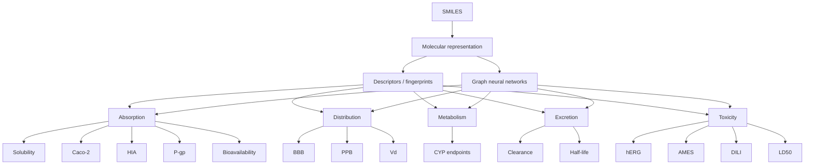

# admet-ml

Machine learning and cheminformatics project for predicting **ADMET properties** directly from molecular structure.

The long-term goal is to build a modular pipeline that takes a molecular **SMILES** string as input and produces predictions for multiple physicochemical and ADMET endpoints, together with an estimate of the model's applicability domain and predictive confidence.

> **Current status:** the first milestone focuses on aqueous solubility using the TDC `Solubility_AqSolDB` benchmark.

---

## Project vision

The intended final output is a molecule-level ADMET profile such as:

```text
SMILES
 │
 ├─ Physicochemical
 │    logS             -2.7 ± 0.5
 │    logP              2.9
 │    MW              341
 │
 ├─ Absorption
 │    Caco-2           moderate
 │    HIA              82 %
 │    P-gp substrate    31 %
 │
 ├─ Distribution
 │    BBB               18 %
 │    PPB               91 %
 │
 ├─ Metabolism
 │    CYP3A4 inhibitor  high risk
 │    CYP2D6 inhibitor  low risk
 │
 ├─ Excretion
 │    clearance         ...
 │    half-life         ...
 │
 └─ Toxicity
      hERG              medium risk
      AMES              low risk
      DILI              medium risk

Applicability domain: HIGH
Overall confidence: MEDIUM
```

The values above are illustrative only and represent the target architecture, not the current implemented output.

---

## Current milestone: aqueous solubility

The first stage of the project uses the **Therapeutics Data Commons (TDC)** ADMET benchmark `Solubility_AqSolDB`.

The current workflow investigates molecular representations and classical machine-learning models for predicting experimental aqueous solubility from SMILES.

A major emphasis is placed on realistic validation: molecular models are evaluated using scaffold-aware splits rather than relying only on random train/test partitions.

---

## Molecular representations

Current experiments include:

- physicochemical descriptors inspired by Lipinski / Rule of Five;
- ESOL-related descriptors;
- extended molecular descriptor sets;
- MACCS structural keys;
- Morgan fingerprints;
- combinations of descriptors and fingerprints.

Future experiments will investigate:

- selected 3D molecular descriptors;
- graph-based molecular representations;
- graph neural networks.

---

## Models

The initial modelling stage includes:

- `DummyRegressor` as a naive baseline;
- Ridge regression as a linear baseline;
- Random Forest regression;
- Gradient Boosting regression.

The next major milestone is a **custom implementation of Gradient Boosting**, using regression trees as weak learners.

This implementation will be used both as a learning exercise and as a basis for studying problem-specific extensions such as:

- alternative loss functions;
- stochastic subsampling;
- early stopping;
- target-aware weighting;
- improved handling of sparsely represented solubility regions.

---

## Validation strategy

Molecular machine learning is particularly vulnerable to overly optimistic results when structurally similar compounds are present in both training and validation data.

For this reason, the project uses the scaffold-aware train/validation partitions provided by TDC and evaluates models across multiple split seeds.

For regression tasks, the main metrics are:

- **MAE** — primary metric;
- **RMSE** — emphasizes large prediction errors;
- **R²** — proportion of target variance explained.

Evaluation also includes:

- train-validation generalization gaps;
- predicted vs experimental values;
- residual analysis;
- error across solubility ranges;
- molecule-level failure analysis;
- stability across scaffold splits.

---

## Repository structure

```text
admet-ml/
├── notebooks/
│   ├── 01_data_acquisition.ipynb
│   ├── 02_data_exploration.ipynb
│   ├── 03_feature_engineering.ipynb
│   ├── 04_model_training.ipynb
│   └── 05_model_evaluation.ipynb
│
├── src/
│   └── __init__.py
│
├── requirements.txt
└── README.md
```

The notebooks currently form the main experimental pipeline.

Reusable modelling, feature-engineering and cheminformatics components will progressively be moved into `src/` as the project matures.

---

## Workflow

The current project pipeline is organized as follows:

```text
SMILES
  │
  ▼
Data acquisition
  │
  ▼
Exploratory data analysis
  │
  ▼
Molecular feature engineering
  │
  ▼
Baseline model training
  │
  ▼
Scaffold-aware validation
  │
  ▼
Model evaluation
  │
  ▼
Interpretability and custom modelling
```

---

## Current modelling questions

The current solubility milestone focuses on several questions:

- How well do classical molecular descriptors and fingerprints generalize to unseen scaffolds?
- Which molecular representations provide useful predictive signal?
- How large is the train-validation generalization gap?
- Do models exhibit systematic bias in extreme solubility regions?
- Can alternative boosting strategies reduce regression toward the mean?
- Can a custom Gradient Boosting implementation match or improve standard baselines?

---

## Interpretability

Interpretability will be incorporated progressively into the modelling pipeline.

Planned methods include:

- permutation importance;
- SHAP values;
- global feature importance;
- local molecule-level explanations;
- analysis of model behaviour on high-error compounds.

The objective is not only to obtain accurate predictions, but also to understand which molecular properties drive them.

---

## Applicability domain and uncertainty

A future stage of the project will introduce an applicability-domain framework.

The goal is to distinguish between:

- predictions made in well-represented regions of chemical space;
- predictions made for molecules structurally different from the training set;
- predictions associated with high uncertainty.

The final system is expected to report both:

Applicability domain
Prediction confidence

alongside the ADMET predictions.

## Roadmap

- [x] Acquire the first TDC ADMET benchmark dataset.
- [x] Perform exploratory analysis of AqSolDB.
- [x] Build descriptor, MACCS and Morgan representations.
- [x] Establish classical regression baselines.
- [x] Evaluate models across scaffold-aware splits.
- [x] Analyse train-validation generalization gaps.
- [x] Perform residual and error-range analysis.
- [ ] Implement Gradient Boosting from first principles at the ensemble level.
- [ ] Add early stopping.
- [ ] Add stochastic subsampling.
- [ ] Evaluate alternative loss functions.
- [ ] Study target-aware weighting strategies.
- [ ] Add model interpretability with permutation importance.
- [ ] Add SHAP-based interpretation.
- [ ] Evaluate selected 3D descriptors.
- [ ] Add additional ADMET regression endpoints.
- [ ] Add ADMET classification endpoints.
- [ ] Introduce graph neural network molecular representations.
- [ ] Implement applicability-domain estimation.
- [ ] Add prediction-confidence / uncertainty estimates.
- [ ] Build a unified molecule-level ADMET prediction interface.

---

## Installation

Clone the repository:

```bash
git clone https://github.com/alexcorbero/admet-ml.git
cd admet-ml
```

Create a virtual environment:

```bash
python -m venv .venv
```

Activate the environment.

On Windows:

```bash
.venv\Scripts\activate
```

On Linux/macOS:

```bash
source .venv/bin/activate
```

Install dependencies:

```bash
pip install -r requirements.txt
```

```bash
pip install PyTDC --no-deps
```

---

## Main technologies

The project currently uses:

- Python;
- NumPy;
- pandas;
- SciPy;
- scikit-learn;
- RDKit;
- Matplotlib;
- seaborn;
- Therapeutics Data Commons.

---

## Scientific goals

Beyond obtaining predictive performance, this project aims to investigate questions such as:

- How well do classical fingerprints generalize to unseen chemical scaffolds?
- Which molecular representations are most useful for different ADMET endpoints?
- Can custom loss functions reduce systematic prediction bias?
- Can rare or extreme target regions be modelled more effectively?
- How should prediction uncertainty be represented?
- How should the applicability domain of an ADMET model be defined?
- When do graph-based representations improve over engineered descriptors and fingerprints?
- Can mathematically motivated modifications to Gradient Boosting improve generalization?

---

## Long-term goal

The final objective is to move from a single-endpoint regression experiment toward a unified molecular prediction system:

```text
SMILES
   │
   ▼
Molecular representation
   │
   ├── descriptors / fingerprints
   └── graph-based representation
   │
   ▼
Multiple ADMET models
   │
   ├── Absorption
   ├── Distribution
   ├── Metabolism
   ├── Excretion
   └── Toxicity
   │
   ▼
Applicability domain
Prediction uncertainty
Interpretability
   │
   ▼
Unified molecule-level ADMET profile
```

---

## Project status

This repository is under active development.

The current implementation should be considered an evolving research and learning project rather than a production-ready ADMET prediction system.