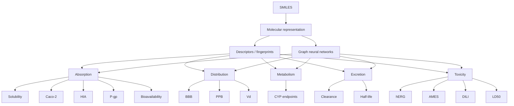

# admet-ml

Machine learning and cheminformatics project for predicting **ADMET properties** directly from molecular structure.

The long-term goal is to build a modular pipeline that takes a molecular **SMILES** string as input and produces predictions for multiple physicochemical and ADMET endpoints, together with an estimate of the model's applicability domain and predictive confidence.

> **Current status:** the first milestone focuses on aqueous solubility using the TDC `Solubility_AqSolDB` benchmark.

---

## Project vision

The intended final output is a molecule-level ADMET profile such as:

```text
SMILES
 │
 ├─ Physicochemical
 │    logS             -2.7 ± 0.5
 │    logP              2.9
 │    MW              341
 │
 ├─ Absorption
 │    Caco-2           moderate
 │    HIA              82 %
 │    P-gp substrate    31 %
 │
 ├─ Distribution
 │    BBB               18 %
 │    PPB               91 %
 │
 ├─ Metabolism
 │    CYP3A4 inhibitor  high risk
 │    CYP2D6 inhibitor  low risk
 │
 ├─ Excretion
 │    clearance         ...
 │    half-life         ...
 │
 └─ Toxicity
      hERG              medium risk
      AMES              low risk
      DILI              medium risk

Applicability domain: HIGH
Overall confidence: MEDIUM
```

The values above are illustrative only and represent the target architecture, not the current implemented output.

---

## Current milestone: aqueous solubility

The first stage of the project focuses on predicting **aqueous solubility** using the Therapeutics Data Commons (TDC) ADMET benchmark **`Solubility_AqSolDB`**.

The current workflow investigates how different molecular representations affect predictive performance, ranging from conventional physicochemical descriptors and molecular fingerprints to increasingly rich **3D geometric and differential-geometric representations** derived from molecular conformers.

Classical machine-learning models, currently centered on **XGBoost**, are used to evaluate the predictive information captured by each representation before moving toward learned geometric models such as graph neural networks.

Particular emphasis is placed on **realistic molecular generalization**. Model performance is therefore evaluated using **scaffold-aware data splits**, which separate structurally distinct molecular scaffolds between training and validation sets and provide a more demanding assessment than conventional random train/test partitioning.
---

## Molecular representations

Current experiments cover a progressively richer set of molecular representations:

- physicochemical descriptors inspired by Lipinski's Rule of Five and ESOL;
- extended molecular descriptor sets;
- MACCS structural keys and Morgan fingerprints;
- combinations of molecular descriptors and fingerprints;
- conformer-derived 3D shape descriptors;
- pairwise atomic-distance statistics;
- element-resolved radial and multiscale density representations;
- differential-geometric representations based on molecular density fields, including mean and Gaussian curvature;
- element-resolved multiscale curvature representations inspired by differential geometry-based geometric learning (DG-GL).

These experiments are designed to evaluate how progressively incorporating **molecular structure, three-dimensional geometry, and local geometric information** affects aqueous-solubility prediction.

Future work will investigate **learned geometric representations**, including graph neural networks in which atoms are represented as nodes, molecular and spatial relationships as edges, and conformer-derived density and curvature information can be incorporated as local atomic features. This will enable direct comparison between manually engineered geometric representations and representations learned from molecular graphs and 3D conformers.


## Geometric representation progression

The geometric component of the project follows a staged progression from conventional molecular representations to increasingly rich descriptions of three-dimensional molecular structure.

Each stage is designed to isolate the contribution of additional geometric information while maintaining a clear comparison with the preceding representations.

| Stage | Representation | Purpose |
|---|---|---|
| **G0** | Conventional descriptors and molecular fingerprints | Non-geometric baseline |
| **G1** | RDKit 3D shape descriptors | Computationally inexpensive 3D baseline |
| **G2** | Pairwise atomic-distance statistics | Rotation- and translation-invariant geometric baseline |
| **G3** | Element-pair radial basis features | Local distance-based representation inspired by continuous-filter molecular models |
| **G4** | Element-resolved multiscale density fields | Continuous representation of the local molecular environment and bridge to differential geometry |
| **G5** | Mean and Gaussian curvature summaries | Differential-geometric characterization of molecular density fields |
| **G6** | Element-resolved multiscale curvature | DG-GL-inspired representation of element-specific geometric interactions |
| **G7** | Geometric graph neural network | Learned geometric representation operating directly on molecular conformers |

Stages **G0–G6** are currently evaluated using the same XGBoost modelling framework so that differences in predictive performance can be attributed primarily to the molecular representation.

**G7** represents a change in modelling paradigm: instead of aggregating geometric information into a fixed-length molecular feature vector, a geometric neural network will operate directly on the three-dimensional molecular graph and learn how local atomic, spatial, density, and differential-geometric information should be combined.


## Models

The current modelling stage uses **XGBoost regression** as the main predictive model.

At this stage, the objective is not to compare different machine-learning algorithms, but to use a consistent and strong supervised-learning model to evaluate the information captured by the different molecular representations. Keeping the predictive model fixed makes it easier to attribute changes in performance to the representation itself rather than to differences between modelling algorithms.

XGBoost is therefore used to compare representations ranging from conventional 2D molecular descriptors and fingerprints to increasingly rich **3D geometric and differential-geometric features** derived from molecular conformers.

The next major modelling milestone will be the introduction of a **geometric neural network**. Instead of reducing each molecule to a fixed-length vector of engineered features, the molecular conformer will be represented directly as a three-dimensional graph, with atoms as nodes and chemical and spatial relationships as edges.

This will enable the project to investigate learned geometric representations and to incorporate local conformer-derived information, such as multiscale density and curvature features, directly at the atomic level.

## Validation strategy

Molecular machine learning is particularly vulnerable to overly optimistic results when structurally similar compounds are present in both training and validation data.

For this reason, the project uses the scaffold-aware train/validation partitions provided by TDC and evaluates models across multiple split seeds.

For regression tasks, the main metrics are:

- **MAE** — primary metric;
- **RMSE** — emphasizes large prediction errors;
- **R²** — proportion of target variance explained.

Evaluation also includes:

- train-validation generalization gaps;
- predicted vs experimental values;
- residual analysis;
- error across solubility ranges;
- molecule-level failure analysis;
- stability across scaffold splits.


## Repository structure

```text
admet-ml/
├── notebooks/
│   ├── 01_data_acquisition.ipynb
│   ├── 02_data_exploration.ipynb
│   ├── 03_feature_engineering.ipynb
│   ├── 04_model_training.ipynb
│   ├── 05_model_evaluation.ipynb
│   └── 07_geometry_representation.ipynb
│
├── src/
│   ├── __init__.py
│   │
│   └── features/
│       ├── __init__.py
│       ├── conformers.py
│       ├── descriptors_3d.py
│       ├── distance_features.py
│       ├── radial_features.py
│       ├── density_features.py
│       ├── curvature_features.py
│       └── dg_gl_features.py
│
├── requirements.txt
└── README.md
```

The project separates exploratory and experimental workflows from reusable feature-engineering code.

The `notebooks/` directory contains the main experimental pipeline, from dataset acquisition and exploratory analysis to model training, evaluation, and the investigation of geometric molecular representations.

The `src/features/` package contains reusable components for generating and analysing 3D molecular representations:

- `conformers.py` — generation and handling of molecular conformers;
- `descriptors_3d.py` — conventional conformer-derived 3D descriptors;
- `distance_features.py` — pairwise atomic-distance representations;
- `radial_features.py` — element-resolved radial representations;
- `density_features.py` — multiscale molecular density fields;
- `curvature_features.py` — differential-geometric features derived from molecular density fields;
- `dg_gl_features.py` — element-resolved multiscale curvature representations inspired by DG-GL.

As the project moves toward learned geometric representations, additional modules will be introduced for molecular graph construction, atom- and edge-level geometric features, and geometric neural-network models.
The notebooks currently form the main experimental pipeline.


## Workflow

## Workflow

The current project pipeline is organized as follows:

```text
SMILES
  │
  ▼
Data acquisition
  │
  ▼
Exploratory data analysis
  │
  ▼
Molecular representation
  │
  ├── 2D descriptors / fingerprints
  │
  └── 3D conformer generation
          │
          ▼
      Geometric representations
      G1 → G2 → G3 → G4 → G5 → G6
  │
  ▼
XGBoost representation comparison
  │
  ▼
Scaffold-aware validation
  │
  ▼
Model and error analysis
  │
  ▼
Geometric neural networks (G7)
```

## Current modelling questions

The current solubility milestone focuses on the following questions:

- How well do conventional 2D molecular descriptors and fingerprints generalize to unseen scaffolds?
- How much predictive information is added by progressively richer 3D molecular representations?
- Which geometric features provide complementary signal beyond classical descriptors and fingerprints?
- Do multiscale density and differential-geometric representations improve aqueous-solubility prediction?
- How large is the train-validation generalization gap for each molecular representation?
- Do different representations exhibit systematic bias in poorly represented or extreme solubility regions?
- Can combining conventional molecular descriptors with geometric representations improve predictive performance?
- How much of the useful 3D information can be captured through engineered geometric features before moving to learned representations?
- Can geometric neural networks learn more informative molecular representations directly from 3D molecular graphs and local density or curvature information?


## Interpretability

Interpretability will be incorporated progressively into the modelling pipeline.

Planned methods include:

- permutation importance;
- SHAP values;
- global feature importance;
- local molecule-level explanations;
- analysis of model behaviour on high-error compounds.

The objective is not only to obtain accurate predictions, but also to understand which molecular properties drive them.

## Applicability domain and uncertainty

A future stage of the project will introduce an applicability-domain framework.

The goal is to distinguish between:

- predictions made in well-represented regions of chemical space;
- predictions made for molecules structurally different from the training set;
- predictions associated with high uncertainty.

The final system is expected to report both:

Applicability domain
Prediction confidence

alongside the ADMET predictions.


## Roadmap

### Aqueous-solubility benchmark

- [x] Acquire the TDC `Solubility_AqSolDB` benchmark dataset.
- [x] Perform exploratory analysis of AqSolDB.
- [x] Establish scaffold-aware training and validation splits.
- [x] Build physicochemical descriptor representations.
- [x] Build MACCS and Morgan fingerprint representations.
- [x] Evaluate combinations of descriptors and fingerprints.
- [x] Establish XGBoost as the reference model for representation comparison.
- [x] Analyse train-validation generalization gaps.
- [x] Perform residual and solubility-range error analysis.

### Geometric molecular representations

- [x] Generate and process 3D molecular conformers.
- [x] Evaluate conventional 3D molecular descriptors.
- [x] Build pairwise atomic-distance representations.
- [x] Build element-resolved radial representations.
- [x] Build multiscale molecular density representations.
- [x] Develop differential-geometric representations based on molecular density fields.
- [x] Compute element-resolved mean and Gaussian curvature features.
- [x] Develop multiscale element-interaction curvature representations inspired by DG-GL.
- [ ] Evaluate combinations of conventional 2D and geometric representations.
- [ ] Analyse which geometric feature families provide complementary predictive signal.
- [ ] Perform feature-importance analysis of the geometric representations.

### Learned geometric representations

- [ ] Represent molecular conformers as 3D molecular graphs.
- [ ] Build atom-level chemical and geometric node features.
- [ ] Incorporate spatial and chemical edge information.
- [ ] Implement a baseline geometric graph neural network.
- [ ] Incorporate multiscale density information as atom-level features.
- [ ] Incorporate local differential-geometric information such as density gradients and curvature.
- [ ] Compare engineered geometric representations with learned geometric representations.
- [ ] Investigate multiple-conformer molecular representations.

### Model analysis and interpretation

- [ ] Add permutation-based feature importance.
- [ ] Add SHAP-based interpretation.
- [ ] Investigate applicability-domain estimation.
- [ ] Add prediction-confidence and uncertainty estimates.

### Extension to broader ADMET modelling

- [ ] Add additional ADMET regression endpoints.
- [ ] Add ADMET classification endpoints.
- [ ] Evaluate transferability of molecular representations across ADMET tasks.
- [ ] Build a unified molecule-level ADMET prediction interface.


## Installation

Clone the repository:

```bash
git clone https://github.com/alexcorbero/admet-ml.git
cd admet-ml
```

Create a virtual environment:

```bash
python -m venv .venv
```

Activate the environment.

On Windows:

```bash
.venv\Scripts\activate
```

On Linux/macOS:

```bash
source .venv/bin/activate
```

Install dependencies:

```bash
pip install -r requirements.txt
```

```bash
pip install PyTDC --no-deps
```


## Main technologies

The project currently uses:

- Python;
- NumPy;
- pandas;
- SciPy;
- scikit-learn;
- RDKit;
- Matplotlib;
- seaborn;
- Therapeutics Data Commons.


## Scientific goals

Beyond maximizing predictive performance, this project aims to investigate how molecular representation influences the ability of machine-learning models to generalize across chemical space.

The main scientific questions include:

- How well do conventional molecular descriptors and fingerprints generalize to unseen chemical scaffolds?
- How much predictive information is gained by incorporating three-dimensional molecular geometry?
- Which geometric representations provide complementary information beyond conventional 2D descriptors and fingerprints?
- Can multiscale molecular density fields and differential-geometric quantities such as curvature capture structural information relevant to ADMET properties?
- Which geometric scales and element-specific interactions are most informative for aqueous-solubility prediction?
- When do learned graph-based representations improve over engineered molecular representations?
- Can geometric neural networks benefit from explicitly incorporating local density and differential-geometric information at the atomic level?
- How robust are different molecular representations in sparsely populated or extreme regions of the target distribution?
- How transferable are molecular representations across different ADMET regression and classification endpoints?
- How should prediction uncertainty and the applicability domain of ADMET models be characterized?


## Long-term goal

The final objective is to move from a single-endpoint regression experiment toward a unified molecular prediction system:

```text
SMILES
   │
   ▼
Molecular representation
   │
   ├── descriptors / fingerprints
   └── graph-based representation
   │
   ▼
Multiple ADMET models
   │
   ├── Absorption
   ├── Distribution
   ├── Metabolism
   ├── Excretion
   └── Toxicity
   │
   ▼
Applicability domain
Prediction uncertainty
Interpretability
   │
   ▼
Unified molecule-level ADMET profile
```

---

## Project status

This repository is under active development.

The current implementation should be considered an evolving research and learning project rather than a production-ready ADMET prediction system.
